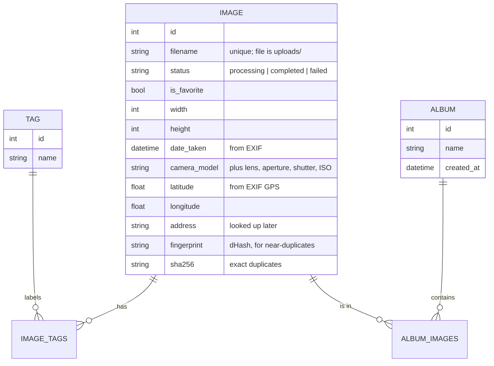
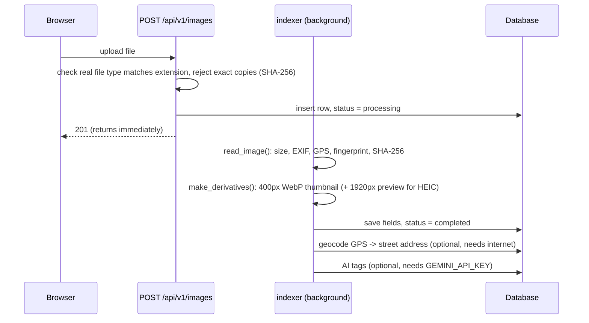

# PhotoStack architecture

PhotoStack is a self-hosted photo library: drop photos in, and it indexes them
(dates, camera, GPS, thumbnails), groups them into albums, puts them on a map,
finds duplicates, and lets you search. One Python process serves both the API
and the built React app.

```
Browser (React SPA)
   │  JSON over /api/v1/...        images over /uploads/...
   ▼
FastAPI app (photostack/main.py)
   ├── routers/        HTTP endpoints: validate input, call crud, shape output
   ├── crud.py         every database query lives here
   ├── indexer.py      file -> database row (EXIF, thumbnails, fingerprint)
   ├── video.py        videos: ffprobe metadata + one ffmpeg frame (optional)
   ├── integrity.py    file type, SHA-256, hidden data, editing software
   ├── storage.py      the only code that knows the uploads/ folder layout
   └── services/       optional outside calls: geocoding (Nominatim), AI tagger (Gemini)
   ▼
SQLite (default) or Postgres          uploads/ folder on disk
```

## Data model



Everything about one photo is one row: each photo has exactly one set of EXIF
data and one location, so separate tables would only add joins. Tags and albums
are many-to-many, so they get join tables. **Month albums are not stored**: they
are a query grouping photos by `date_taken`.

## What happens when a photo arrives



Steps after "save" can fail without losing the photo. At startup the same
indexer scans `uploads/` for files added directly to the folder, or that
failed before.

## Design decisions

| Decision | Why |
|---|---|
| **SQLite by default**, Postgres optional | No database server to run; a personal library fits easily. `DATABASE_URL` switches it. |
| **No migrations tool** | The database is derived from the files: delete it and the startup scan rebuilds it. Only favorites and custom albums are user data. Add Alembic once that matters. |
| **FastAPI `BackgroundTasks`**, not a job queue | Indexing one photo takes well under a second. A queue (Celery/Redis) would add two services for no gain at this scale. |
| **Thumbnails as WebP files**, served statically | Generated once at index time; the browser loads them like any other file. |
| **dHash fingerprint** for duplicates | ~10 lines on top of Pillow. Resized or re-saved copies get the same hash. Replaced `imagehash`, which pulled in numpy and scipy. |
| **Plain keyword search** | Every word must match the filename, camera, address, or a tag. Predictable, and explainable in one sentence. |
| **Videos via the ffmpeg command line, never converted** | `ffprobe` gives size, duration, date and GPS; one `ffmpeg` frame becomes the thumbnail. The original file is played as-is. Converting would take minutes per video. If a browser can't decode a format (often iPhone HEVC), the viewer offers a download. Without ffmpeg installed, videos are still stored and playable, just without thumbnails. |
| **AI only as an optional plugin** | The tagger is off without an API key, sends just the small thumbnail, and runs after the photo is saved, so it can never break indexing. |
| **`storage.py` owns the folder layout** | URLs and paths for originals, thumbnails and previews come from one place, so delete and serve can't disagree. |

## Code map

| File | What it does |
|---|---|
| `photostack/main.py` | Creates the app, mounts routers and static files, starts the startup scan. |
| `photostack/config.py` | Settings from environment variables / `.env`. |
| `photostack/models.py` | Database tables (SQLAlchemy 2.0). |
| `photostack/schemas.py` | API response and request shapes (Pydantic). |
| `photostack/crud.py` | All queries: list/filter/search, albums, duplicates, stats. |
| `photostack/indexer.py` | Reading a photo and storing what's in it. |
| `photostack/video.py` | ffprobe/ffmpeg calls for video metadata and thumbnails. |
| `photostack/integrity.py` | Byte-level checks used at upload and index time. |
| `photostack/storage.py` | Where files live and their URLs. |
| `photostack/routers/` | One file per resource: images, albums, search, map, filters, library (health), duplicates, batch. |
| `photostack/services/` | Geocoding and the optional AI tagger. |
| `frontend/src/lib/api.ts` | Typed client for every endpoint. |
| `frontend/src/hooks/useApi.ts` | React Query hooks (caching, refetch after changes). |
| `frontend/src/pages/` | One component per screen. |
| `tests/` | API, indexer, albums, integrity and tagger tests (pytest, SQLite, generated images). |

## Running checks

```bash
uv run pytest            # backend tests
uv run ruff check        # lint
npm --prefix frontend run typecheck
```
